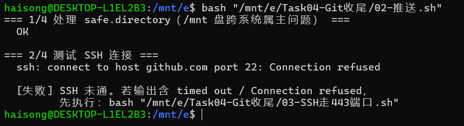
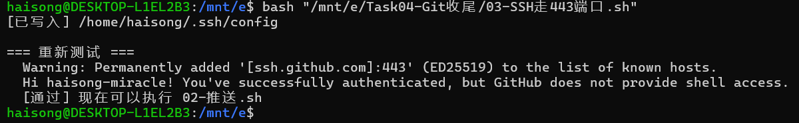
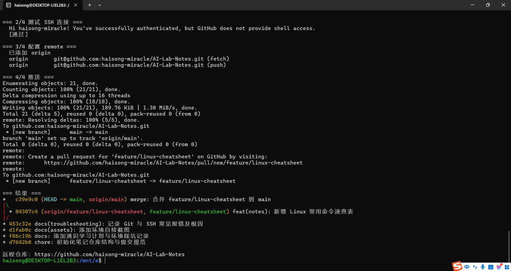
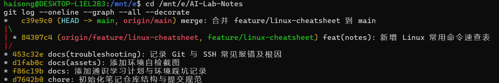
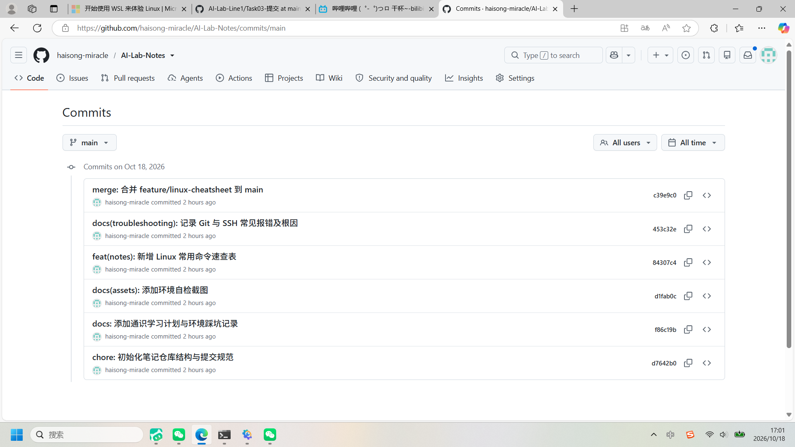

# Task 04 · Git 版本管理规范与 GitHub 协作

> 作业成果仓库：<https://github.com/haisong-miracle/AI-Lab-Notes>（本目录为该任务的成果存档与操作佐证）

## 一、完成内容

1. **初始化协作仓库 `AI-Lab-Notes`**，建立目录结构与提交规范：
   ```
   AI-Lab-Notes/
   ├── 10-环境配置/          # 环境相关笔记
   ├── 20-排错记录/          # Git 与 SSH 常见报错及根因
   ├── 30-代码实验/          # Linux 常用命令速查表
   ├── 40-文献摘记/          # 预留
   └── README.md             # 索引 + 提交规范表
   ```
2. **6 次语义化提交**（Conventional Commits）：`chore` 初始化 → `docs` 学习计划 → `docs(assets)` 自检截图 → `feat` 命令速查表 → `docs(troubleshooting)` 排错记录 → `merge` 分支合并；
3. **分支协作模型**：在 `feature/linux-cheatsheet` 分支开发速查表，用 `git merge --no-ff` 合入 `main`，保留清晰的合并节点；
4. **SSH 免密推送**：生成 ed25519 密钥并添加到 GitHub；校园网封禁 22 端口后，改走 `ssh.github.com:443` 通道完成推送。

## 二、分支与合并（git log --graph）

```
*   c39e9c0 (HEAD -> main, origin/main) merge: 合并 feature/linux-cheatsheet 到 main
|\
| * 84307c4 (origin/feature/linux-cheatsheet, feature/linux-cheatsheet) feat(notes): 新增 Linux 常用命令速查表
|/
* 453c32e docs(troubleshooting): 记录 Git 与 SSH 常见报错及根因
* d1fab0c docs(assets): 添加环境自检截图
* f86c19b docs: 添加通识学习计划与环境踩坑记录
* d7642b0 chore: 初始化笔记仓库结构与提交规范
```

`--no-ff` 强制生成合并提交，历史图上能一眼看出"哪段工作是在功能分支上完成的"。

## 三、SSH 连 GitHub 的排错记录

| 现象 | 根因 | 解决 |
|---|---|---|
| `ssh: connect to host github.com port 22: Connection refused` | 校园网出口防火墙封禁 22 端口 | `~/.ssh/config` 将 github.com 指向 `ssh.github.com:443` |

```
Host github.com
    HostName ssh.github.com
    Port 443
    User git
```

验证输出：`Hi haisong-miracle! You've successfully authenticated, but GitHub does not provide shell access.`
（注：该输出配合退出码 1 属于正常现象，"successfully authenticated" 即为成功标志。）

详细根因分析见同目录 [`git-ssh-常见报错.md`](git-ssh-常见报错.md)。

## 四、操作截图

### 4.1 排错：SSH 22 端口被拒



### 4.2 改走 443 端口后认证成功



### 4.3 推送成功：main 与 feature 分支同步远端 + 合并图



### 4.4 本地图形化提交历史



### 4.5 GitHub 远端 Commits 页面（6 条语义化提交）



## 五、本次用到的核心命令

```bash
git init && git branch -M main                  # 初始化并命名主分支
git switch -c feature/linux-cheatsheet          # 创建并切换功能分支
git merge --no-ff feature/linux-cheatsheet      # 保留合并节点的合并
git log --graph --all --decorate                # 图形化查看全部分支历史
git remote add origin git@github.com:haisong-miracle/AI-Lab-Notes.git
git push --set-upstream origin main             # 首推并建立跟踪
ssh-keygen -t ed25519 -C "haisong-miracle"      # 生成 ed25519 密钥
ssh -T git@github.com                           # 测试 GitHub 认证
```
