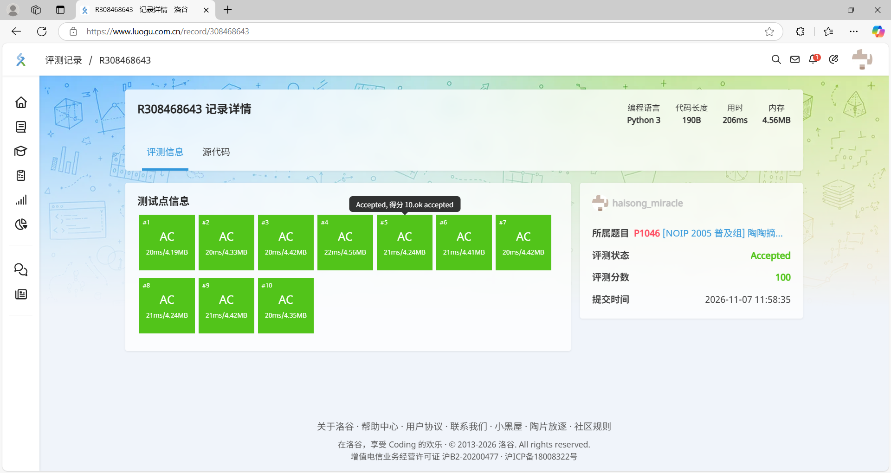
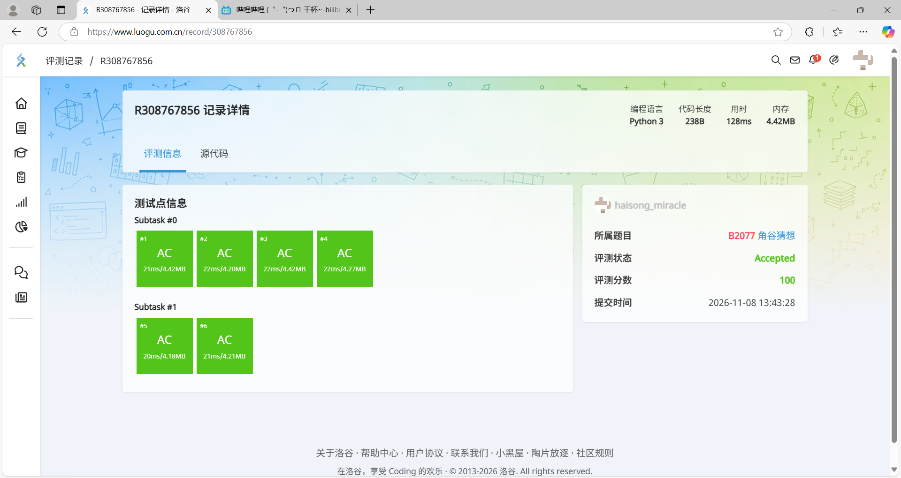
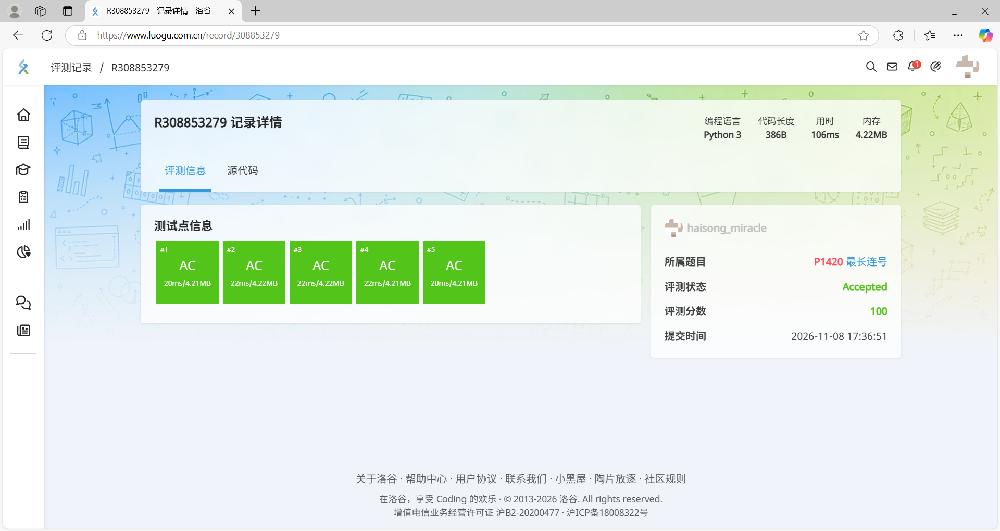
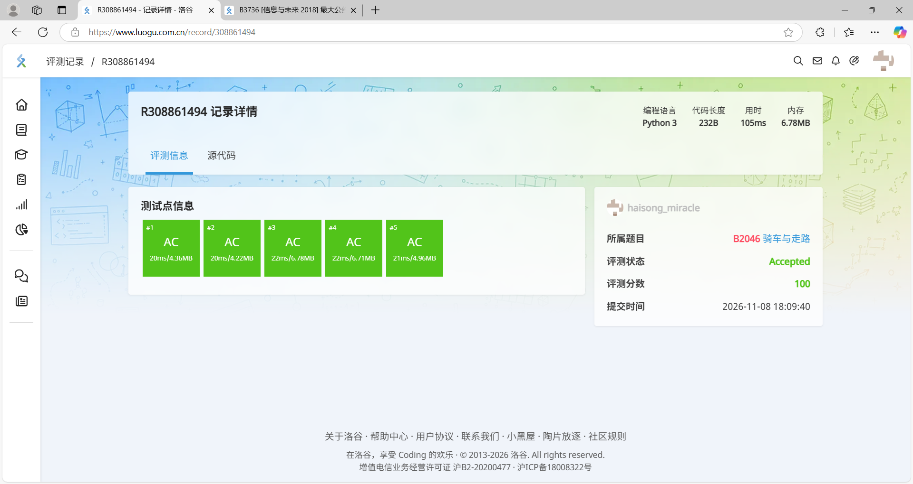
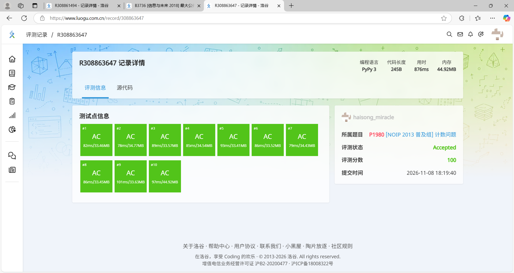

# Task 09 经典算法与编程逻辑专项巩固

> 姓名：海嵩皓　｜　专项：经典算法与编程逻辑　｜　平台：洛谷（luogu.com.cn）

## 一、完成情况

任务书要求「任选通过至少 6 题」，本次共完成 **6 题，全部 Accepted（100 分）**，均为独立编写、独立调试。

| # | 题号 | 题目 | 语言 | 得分 | 耗时 | 提交记录 |
|---|---|---|---|---|---|---|
| 1 | P1046 | 陶陶摘苹果 | Python 3 | 100 | — | [R308468643](https://www.luogu.com.cn/record/R308468643) |
| 2 | B2077 | 角谷猜想 | Python 3 | 100 | — | [R308767856](https://www.luogu.com.cn/record/R308767856) |
| 3 | P1420 | 最长连续自然数 | Python 3 | 100 | 106 ms | [R308853279](https://www.luogu.com.cn/record/R308853279) |
| 4 | B2046 | 骑车与走路 | Python 3 | 100 | 105 ms | [R308861494](https://www.luogu.com.cn/record/R308861494) |
| 5 | P1980 | 计数问题 | PyPy 3 | 100 | 876 ms | [R308863647](https://www.luogu.com.cn/record/R308863647) |
| 6 | B3736 | 最大公约数 | PyPy 3 | 100 | 395 ms | [R308920597](https://www.luogu.com.cn/record/R308920597) |

> 说明：任务书中 B3736 标注为「约数计数」，但洛谷 B3736 的实际题面是「[信息与未来 2018] 最大公约数」（输入三个正整数，求三者的最大公约数），代码按真实题面完成。
>
> P1009（阶乘之和）为选做题，6 题达标后未做。

## 二、代码与 AC 记录

### 1. P1046 陶陶摘苹果

**思路**：第一行 10 个苹果高度收成列表，第二行读伸手高度 `h`；遍历列表，高度 `<= h + 30`（含踩椅子 30 cm）就计数。

**关键点**：题目第一行**没有** n，苹果数量固定 10 个；边界是「正好够到也算够到」，因此用 `<=` 而非 `<`。

```python
apples = list(map(int, input().split()))
h = int(input())
count = 0
for i in apples:
    if i <= h + 30:
        count += 1
print(count)
```



### 2. B2077 角谷猜想

**思路**：`while n != 1` 循环，奇数走 `n*3+1`、偶数走 `n//2`；每步按题目要求输出计算过程（如 `5*3+1=16`），循环结束后输出 `End`。

**关键点**：
- `//` 是整除，保证 n 始终是整数（用 `/` 会变成 `8.0` 这种小数）。
- f-string 里「引号内是打印文字、花括号内才是计算」，所以引号里写 `/2`（一个斜杠），花括号里写 `n // 2`。
- `End` 必须放在 `while` **外面**顶格：这样输入为 1 时（循环一次都不跑）也能输出 `End`，特例自动覆盖。

```python
n = int(input())
while n != 1:
    if n % 2 == 1:
        print(f"{n}*3+1={n * 3 + 1}")
        n = n * 3 + 1
    else:
        print(f"{n}/2={n // 2}")
        n = n // 2
print("End")
```



### 3. P1420 最长连续自然数

**思路**：按原顺序比较相邻两项 `a[i] == a[i-1] + 1`，用 `current_len` 记当前连号长度、`max_len` 记历史最长；断开时先更新 `max_len` 再把 `current_len` 重置为 1。

**关键点**：
- 输入**不保证有序**，题目要的是「连续子串」，不能排序后再找。
- 循环结束后必须再补一次比较：最后一段连号没有「断开」的机会，不补判就会漏。
- 重置 `current_len = 1` 必须放在 `if current_len > max_len` 之外——放进去会变成「只有破纪录才重置」，旧账会累加到下一段头上（这个 bug 是靠自构数据 `1 2 3 8 9 12 13 14 15` 抓出来的）。

```python
n = int(input())
a = list(map(int, input().split()))
max_len = 1
current_len = 1
for i in range(1, n):
    if a[i] == a[i - 1] + 1:
        current_len += 1
    else:
        if current_len > max_len:
            max_len = current_len
        current_len = 1
if current_len > max_len:
    max_len = current_len
print(max_len)
```



### 4. B2046 骑车与走路

**思路**：骑车要先去取车、到地方再停车，固定多花 27 + 23 = 50 秒，骑行速度 3 m/s；走路速度 1.2 m/s。比较两个时间，输出 `Bike` / `Walk` / `All`。

**关键点**：比较的是**时间**不是距离；「恰好一样快」的边界单独用 `else` 兜住（样例 s = 100 正是这个临界点，两个数舍入后恰好相等，输出 `All`）。

```python
s = float(input())
bike_time = 50 + s / 3.0
walk_time = s / 1.2
if bike_time < walk_time:
    print("Bike")
elif bike_time > walk_time:
    print("Walk")
else:
    print("All")
```



### 5. P1980 计数问题

**思路**：枚举 1 到 n 的每个数，逐位拆解统计目标数字 x 出现次数：`temp % 10` 取个位比对，`temp //= 10` 去掉个位，直到 temp 变 0。拆位前先把 i 复制给 temp，保证外层循环变量不被破坏。

**关键点（本题最有价值的一段调试经历）**：
- 首次提交用 Python 3：**7 个点 AC、3 个点 TLE（70 分）**，超时的三点用时 1.05–1.06 s，只差 60 ms——逻辑完全正确，输在解释器速度。
- 改用 **PyPy 3** 提交（代码一字未改，仅切换语言），10 个点全绿、总耗时 876 ms，从 70 分变成 100 分。
- 收获：**WA 是「想错了」，TLE 是「想对了但太慢」**，处置方式完全不同；更换运行时也是正当的工程手段。

```python
n, x = map(int, input().split())
count = 0
for i in range(1, n + 1):
    temp = i
    while temp > 0:
        if temp % 10 == x:
            count += 1
        temp //= 10
print(count)
```



### 6. B3736 最大公约数

**思路**：三个数的公约数不可能大于三者中的最小值，所以从 `min(x, y, z)` 开始**倒序**枚举，第一个能同时整除三个数的 g 就是最大公约数，打印后立即 `break`。

**关键点**：`range(min_num, 0, -1)` 是倒着数的（步长 -1）；从大到小找，命中的第一个天然就是「最大」。

```python
x, y, z = map(int, input().split())
min_num = min(x, y, z)
for g in range(min_num, 0, -1):
    if x % g == 0 and y % g == 0 and z % g == 0:
        print(g)
        break
```


## 三、解题方法总结

1. **读题三问**：输入几行几个数？要算的是什么？边界卡在哪（正好相等算不算）？
2. **两种输入模板**：一行多个数 → `list(map(int, input().split()))`；一行一个数 → `int(input())`。
3. **拆位套路**：`% 10` 取末位、`//= 10` 去末位，配 `while temp > 0` 循环。
4. **调试四步**：样例手算 → 中间结果 `print` 出来看 → 自构刁钻数据（如非破纪录的断开、正好相等的边界）→ 报错只看最后一行 `line xx`。
5. **结果分类**：WA / TLE / RE / CE 含义不同，先分清再动手；Python 在 10^6 量级卡常时可换 PyPy 3。

## 四、目录结构

```
src/luogu/
├── README.md          # 本说明文档
├── P1046.py           # 陶陶摘苹果
├── B2077.py           # 角谷猜想
├── P1420.py           # 最长连续自然数
├── B2046.py           # 骑车与走路
├── P1980.py           # 计数问题
├── B3736.py           # 最大公约数
└── 截图/               # 6 张洛谷 Accepted 记录截图
    ├── P1046.png
    ├── B2077.png
    ├── P1420.png
    ├── B2046.png
    ├── P1980.png
    └── B3736.png
```
